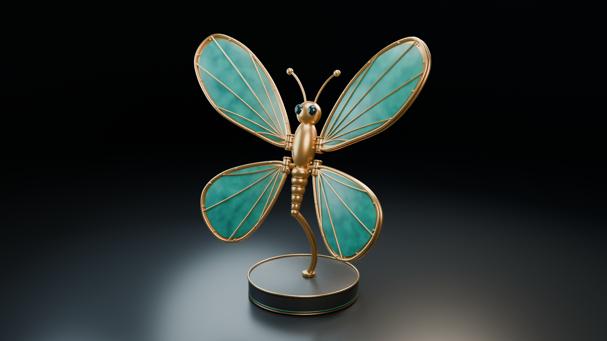

# Papilio butterfly animation

A 12-second, 1080p, 24 fps kinetic sculpture built using the SVG & 3D Design workflow, GPT Image references, and Blender 5.3.

- [Watch the animation and explore the visual guide](https://az9713.github.io/papilio-butterfly-animation/)
- [Download or play the final film](papilio-final-1080p.mp4)
- [Open the editable Blender scene](stages/final-v01/final-v01.blend)
- [Local HTML guide](index.html): after cloning or downloading the repository, open `index.html` in a browser. The live guide is published through GitHub Pages from `main`, at the repository root.
- [Production recap](production-recap.jpg)

The HTML guide is the complete project documentation. It contains the exact image prompts, tool inputs/outputs, dependencies, commands, and validation limits. The image tool did not expose an exact model version. The Blender scene has no external texture dependencies. The movie is unchanged from the completed production delivery.

Raw frame caches, logs, credentials, and private conversation material are excluded. Blender checkpoint path metadata and JSON receipt paths have been made relative, and PNG metadata has been removed with pixel bytes verified unchanged. Original local production artifacts are preserved separately.
