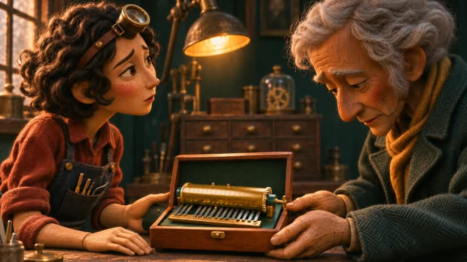

# The Tooth That Didn’t Sing

An accepted sixteen-second animation about a music-box repair that takes away its customer's place in a tune. He sings the missing note, the repaired box interrupts him, and he reclaims the same note after the tooth is removed.

[Watch the film with sound](https://az9713.github.io/animation-studio/projects/tooth/) · [Download the MP4](film.mp4) · [Public source ZIP](downloads/tooth-accepted-source.zip)

## Project contents

| Path | Contents |
| --- | --- |
| film.mp4 | Accepted 16-second, 960 × 540, 24 fps film with stereo AAC. |
| pass-1.mp4, pass-2.mp4, pass-3.mp4 | Sound-on excerpts of his note, the interruption and the return. |
| production/revision-5/ | Shared timeline, SVG score, source plates, prepared vocal, sound/edit scripts and delivery tests. |
| production/ | Shared character plate, original Blender mechanism and background instrumental. |
| history/ | Four earlier films and the revision 4 assessment. |
| receipts/ | Generation, sound, playback, rebuild, iteration and acceptance evidence. |
| assessment.md | Evidence-based scores and the relationship to the thirty-concept forecast. |
| downloads/ | Public source package with local Blender path metadata sanitized. |

The accepted film has SHA-256 f74fbace55b2df53256e07a3df4cfed3fc81dc5d191efca2aa7bda8e69b17b74.

## Rebuild from this repository

Use the environment recorded by the production instructions. From this project folder, change into production/revision-5 and run these commands.

~~~powershell
python sound.py
python cut.py
python screen.py
python test_delivery.py
~~~

The commands write their outputs inside production/revision-5. The accepted film at the project root is the published reference artifact. [Detailed production instructions](production/revision-5/README.md)

The public ZIP is one combined package. Extract it into a fresh folder and run the same commands from revision-5. Its cached Blender layers support an exact editorial rebuild. The original generation calls are optional and use a separately supplied key. A rebuild uses the included media.

## Evaluation

The accepted prototype scores **3 / 3 / 3 / 3 / 3** for Intent, Appearance, Motion, Delivery and Editability. The requesting viewer accepted revision 5 after earlier cuts failed to communicate the characters and singing role.

The first full vocal runs from 3.50 to 4.70 seconds. His next attempt starts at 8.00 seconds, metal enters at 8.25 and his voice stops at 8.30. After removal, the same full note returns at 14.00–15.20. The earlier synthetic breath/hiss cues were removed.

Technical checks cover the actual encoded voices, their interruption and return, jaw and tooth states, full playback and a clean source rebuild. The recorded audience acceptance is from one returning viewer. [Assessment](assessment.md)

## Creative workflow

This is concept 22 in the AAT-inspired catalog. Its music-box anchor is Getty AAT 300042659. Codex coordinated GPT Image plates, editable SVG/Blender construction, ElevenLabs audio, Python compositing, FFmpeg encoding and the iteration record.

[Shared tool workflow](../../docs/workflow.md) · [Getty AAT and concept discovery](../../docs/getty-aat.md) · [Rubric](../../docs/rubric.md) · [Thirty original proposals](../../docs/concepts-archive.md)

[Back to the studio](../../README.md) · [Peer butterfly project](../butterfly/README.md)
